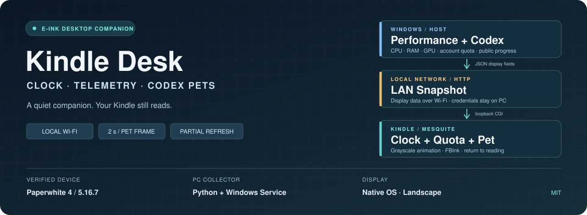
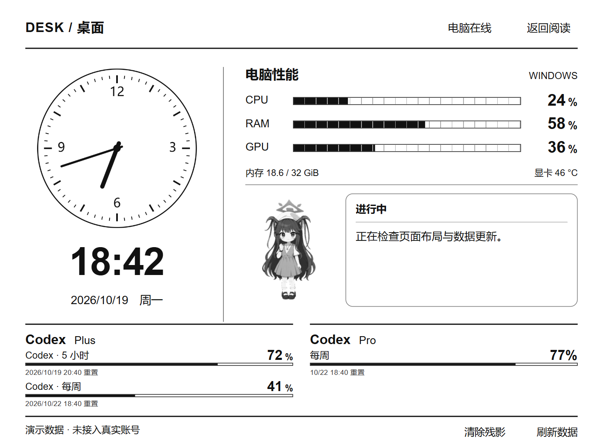

<p align="center">
  
</p>

<h1 align="center">Kindle Desk</h1>

<p align="center"><strong>让 Kindle 成为桌面上的时钟、电脑仪表和 Codex 宠物伴侣，随时回到原系统阅读。</strong></p>

<p align="center">横屏墨水屏 · Windows 性能 · 双账号额度 · 点阵宠物 · A2 局部刷新</p>

<p align="center">
  <a href="https://github.com/ryujou/kindle-desk/releases/tag/v0.2.0"></a>
  
  
  
  
  
</p>

<p align="center">
  <a href="#项目亮点">项目亮点</a> · <a href="#界面预览">界面预览</a> · <a href="#从原版-kindle-开始">Kindle 越狱</a> · <a href="#windows-数据服务">电脑服务</a> · <a href="#安装到-kindle">设备安装</a> · <a href="#codex-宠物与公开进度">宠物配置</a> · <a href="#工程入口">源码与测试</a>
</p>

Kindle 原系统 + HTML / CSS / ES5 JavaScript，Windows 端使用 Python 标准库和 .NET Framework 服务宿主。

横屏显示指针时钟、电脑性能、Codex 额度和宠物伴侣。点击“返回阅读”回到原生书库，保留 Kindle 的阅读功能。时钟按分钟更新；任务期间宠物沿用图集的原生帧时长，以加深的 Floyd–Steinberg 点阵配合 FBInk A2 局部刷新。闲置时显示日常对白、一言和可选环境读数，宠物低频活动。点击人物依次播放挥手、跳跃、向右跑、向左跑，每个动作播放 3 遍后恢复跟随 Codex 状态。

实机开发环境为 **Kindle Paperwhite 4（第 10 代）、固件 5.16.7**。其他型号或固件需要分别确认越狱、Mesquite 和 FBInk 兼容性，不能仅凭分辨率相同判断可用。电脑端面向 Windows 10/11，使用 Python 3.12 和 PowerShell 7。

## 项目亮点

| 区域 | 显示内容 |
| --- | --- |
| 时钟 | 指针时钟、数字时间、日期和星期，固定 UTC+8 |
| 电脑性能 | CPU、RAM、GPU 使用率，内存容量，GPU 温度 |
| 当前账号 | Codex app-server 返回的套餐与剩余额度 |
| 第二账号 | CC Switch 中另一个 OAuth 账号的剩余额度 |
| 宠物 | 跟随电脑当前账号的宠物选择，A2 点阵动画，点击切换动作 |
| 闲置显示 | 风香原创对白、精选一言与早晚、久坐、降雨提醒；短句按语义换行 |
| 环境读数 | 可选 Open-Meteo 当地天气、小米空气净化器 2 的本地温湿度和 PM2.5 |
| 进度气泡 | 指定 Codex 会话的公开进度、完成状态及部分待回答问题 |

Plus、Pro 使用相同的排版和数据规则：有 5 小时窗口就显示 5 小时，有每周窗口就显示每周；没有返回的窗口不补造。剩余量为 `100 − usedPercent`，到达重置时间后等待真实新数据，不直接显示 100%。

GPU 目前读取 NVIDIA 第 0 张显卡的 `nvidia-smi`。没有 NVIDIA 显卡或指标不可用时显示横线，CPU 和内存仍可使用。宠物素材与会话绑定均为可选项。

## 界面预览



上图使用作者授权展示的宠物形象，展示界面布局；实机宠物以黑白抖动模拟灰度。电脑性能、额度和进度文字均为演示数据，不包含真实账号或会话。Plus 示例显示 5 小时与每周窗口，Pro 示例仅显示每周窗口；宠物原始图集不随源码分发。

## 安装顺序

1. 确认 Kindle 型号和固件，备份书籍，按对应流程越狱。
2. 验证 KMC / Scriptlets 和更新屏蔽状态。
3. 在电脑预览页面，安装 Windows 服务与当前用户采集任务。
4. 配置局域网地址，将设备文件复制到 Kindle。
5. 在书库执行 Setup，打开仪表盘。
6. 按需配置宠物、会话进度和第二账号。

源码包不包含越狱载荷、亚马逊系统文件、设备备份、登录文件、SSH 密钥或宠物图集。下面的越狱流程以 **2026-10-19 查阅的上游文档**为依据；执行时以当前上游向导为准。

## 从原版 Kindle 开始

### 1. 确认设备与备份

在 Kindle 的“设置 → 设备选项 → 设备信息”查看型号和固件版本。菜单名称可能因系统语言稍有差异。记录型号与版本即可，不需要公开序列号或 Wi-Fi MAC。

打开飞行模式，使用数据线连接电脑，将可见存储中的书籍和个人文件复制到电脑上的私人目录。普通 USB 复制仅备份用户存储，不是完整系统镜像。

访问 [KindleModding 越狱说明](https://kindlemodding.org/jailbreaking/) 和 [型号 / 固件向导](https://kindlemodding.org/kindle-models)。由向导选择方法，不要直接套用别人的固件文件或旧教程。越狱用于运行第三方程序，不需要把设备刷成安卓。

### 2. 防止准备期间自动升级

尚未越狱时，联网可能触发更新。按 [上游防更新准备](https://kindlemodding.org/jailbreaking/prevent-auto-update/) 填充存储，并处理已经下载的更新文件。

PW4 是 USB 存储设备，可以使用上游提供的 Windows `Filler.ps1`。将脚本放在 **Kindle 盘符根目录**，确认当前盘符后在该位置执行；不要在电脑系统盘运行。目标剩余空间和填充方式以该页面为准。MTP 型号的处理方式不同，不能照搬 PW4 的盘符操作。

填充文件只是越狱前的临时措施，后续需要完成持久化与 OTA 屏蔽，不能把“存储已满”当作越狱成功。

### 3. SpiderCat 流程

本节仅用于向导已经选中 SpiderCat 的设备；其他方法请使用各自文档。[SpiderCat 上游教程](https://kindlemodding.org/jailbreaking/SpiderCat/) 提供当前下载和操作步骤。

1. 从上游页面下载 SpiderCat 电子书，通过 USB 放进 Kindle 的 `documents` 文件夹。
2. 安全弹出设备并拔掉 USB，在 Kindle 上连接 Wi-Fi。
3. 从书库打开 SpiderCat，保持联网，等待载荷与系统脚本运行。
4. 脚本运行时不要反复打开书籍或断电。上游说明此阶段可能出现应用错误弹窗；关闭弹窗并观察流程是否完成，不能用弹窗本身判断成功或失败。
5. 等待完成提示与重启。回到首页后继续阅读 [What's Next](https://kindlemodding.org/jailbreaking/whats-next/)，确认现代越狱组件安装完成。

如果停在不支持固件、下载失败或其他错误处，应先按上游故障处理检查型号、版本与网络。不要把重新刷系统、恢复出厂设置作为常规重试方法。

### 4. 验证越狱与更新屏蔽

现代流程包含 KPM 和 Scriptlets。重启后，在 Kindle 搜索栏输入：

```text
;kpm update
```

如果命令正常执行，说明包管理入口可用；把可信 `.sh` 脚本放入 `documents` 后，也应能在书库看到并运行。[Scriptlets 与 KPM 使用说明](https://kindlemodding.org/jailbreaking/whats-next/installing-homebrew.html) 解释了这两种入口。

现代越狱流程会自动屏蔽更新，但需要先确认整个安装流程成功完成。按 [What's Next](https://kindlemodding.org/jailbreaking/whats-next/) 检查用户存储根目录里是否有已下载的 `update*.bin` 或 `update.bin.tmp.partial`，再清理对应更新残留与填充文件。不要删除不了解用途的系统目录或越狱持久化文件。

`JAILBROKEN` 一类书库提示、SpiderCat 电子书与系统持久化组件不是同一回事。整理书库时只处理已确认用途的提示或入口文件；本项目安装脚本不负责删除越狱组件，也不通过手动改名 OTA 程序来替代上游流程。

## 电脑预览

无需连接 Kindle，也无需登录 Codex。在仓库根目录打开 PowerShell 7：

```powershell
python ./tests/preview_server.py
```

打开 `http://127.0.0.1:18767/preview`。页面使用正式 Kindle 前端，可切换 Plus、Pro、离线、过期、切换账号和额度重置等模拟场景。退出与刷新操作在浏览器中模拟，不操作实体设备。

Python 数据服务的基础功能只使用标准库；可选的小米本地采集需要 `cryptography`，宠物帧生成工具需要 Pillow。预览不读取本地登录文件；未提供宠物素材时只显示文字和仪表，环境读数使用合成数据。

## Windows 数据服务

### 1. 准备运行环境

安装 Python 3.12、PowerShell 7，并在 Codex 桌面程序中登录账号。将仓库放到固定目录；服务安装后不要移动目录。当前账号额度需要 Codex 的 `app-server` 子命令可用。

默认程序位置为：

```text
%LOCALAPPDATA%\Programs\Python\Python312\python.exe
%LOCALAPPDATA%\Programs\OpenAI\Codex\bin\codex.exe
```

路径不同时通过 `-Python`、`-Codex` 指定实际位置。完整工程目录和 Python 安装目录需允许 LocalService 读取和执行；不要放入其他用户无法读取的加密目录。

### 2. 编译与安装

在项目根目录执行：

```powershell
./pc/manage.ps1 -Action build
```

这会使用 Windows 自带 .NET Framework C# 编译器生成 `pc/KindleDesk.Service.exe`。随后用 **同一 Windows 用户的管理员 PowerShell 7** 安装：

```powershell
./pc/manage.ps1 -Action install
./pc/manage.ps1 -Action status
```

需要指定程序路径时：

```powershell
./pc/manage.ps1 -Action install `
  -Python 'C:\Tools\Python312\python.exe' `
  -Codex 'C:\Tools\Codex\codex.exe'
```

安装包括数据就绪、服务停止释放端口和重启恢复数据的检查。当前用户必须已经登录 Codex，否则额度就绪检查会失败。失败记录在 `pc/install-result.json`，该文件不进入 Git。

| 组件 | 运行身份 | 用途 |
| --- | --- | --- |
| `KindleDesk` Windows 服务 | LocalService | 性能采集、局域网 HTTP 服务，开机延迟启动 |
| `KindleDesk-Codex` 计划任务 | 当前交互用户 | 读取该用户的 Codex、宠物和 CC Switch，登录时启动 |
| `KindleDesk-LAN` 防火墙规则 | 专用网络 / 本地子网 | 放行 TCP 18768 |

安装会授予 LocalService 对 Python 安装目录的读取与执行权限。未登录 Windows 时，性能服务仍可运行，但该用户的额度和宠物采集不可用。

### 3. 查看数据

```powershell
Invoke-RestMethod http://127.0.0.1:18768/health
```

真实界面位于 `http://127.0.0.1:18768/`，快照位于 `/snapshot`，宠物与第二账号摘要位于 `/companion`。

使用 `Get-NetIPConfiguration` 查看电脑当前 Wi-Fi / 以太网的 IPv4。Kindle 和电脑要处于能互相访问的局域网；访客 Wi-Fi 的设备隔离可能阻止连接。将家庭网络设为可信的“专用”网络，不要为此向公网开放端口。

## 安装到 Kindle

### 1. 准备文件

电脑端运行：

```powershell
./tools/prepare-device.ps1
Copy-Item ./kindle/extensions/kindle-desk/config.example.sh `
  ./kindle/extensions/kindle-desk/config.sh
```

准备脚本下载官方 BusyBox 1.31.0 ARMv7 静态构建。编辑新建的 `config.sh`，把 `YOUR_PC_IP` 换成电脑的局域网 IPv4：

```sh
ENDPOINT='http://YOUR_PC_IP:18768/snapshot'
KEEP_AWAKE=1
```

`ENDPOINT` 必须以 `/snapshot` 结尾，伴侣 CGI 会据此访问同一电脑的 `/companion`。保存为 UTF-8、LF 换行，不带 BOM。`KEEP_AWAKE=1` 仅在仪表盘位于前台时重置自动休眠计时，电源键仍可正常锁屏。

### 2. USB 复制与启动

把 `kindle` 目录 **内部** 的 `extensions` 和 `documents` 合并复制到 Kindle 可见存储根目录，最终结构如下：

```text
Kindle USB 根目录/
├── documents/
│   ├── KindleDesk.sh
│   ├── KindleDesk-Stop.sh
│   ├── KindleDesk-Setup.sh
│   └── KindleDesk-Uninstall.sh
└── extensions/kindle-desk/
    ├── app/
    ├── bin/busybox
    ├── config.sh
    ├── setup.sh
    ├── session.sh
    ├── start.sh
    └── stop.sh
```

安全弹出并拔掉 USB，回到 Kindle 书库：

1. 打开 **Kindle Desk Setup**。
2. Setup 从设备已有 KMC 的 `/var/local/kmc/kindlehf/bin/fbink` 复制刷新工具，并检查 BusyBox 能否启动。
3. 出现就绪信息后，打开 **Kindle Desk**。
4. 等待页面切换为横屏，检查“电脑在线”和性能数值。

Setup 的 FBInk 路径对应已验证的现代 KMC / kindlehf 环境。如果报告文件缺失，先确认越狱组件和平台兼容性，不要随意下载旧 armel 二进制替换。

点击“返回阅读”退出。也可从书库打开 **Kindle Desk Stop**。应用不设置 Kindle 开机自启动；原生系统状态栏保留，并随系统原生横屏方向旋转。

## Codex 宠物与公开进度

### 宠物素材

宠物选择读取当前用户的 `.codex/auth.json` 中的账号标识，以及 `.codex/.codex-global-state.json` 的本地已观察选择。账号标识仅用于本机匹配；前端收到宠物名称、图集地址和状态。

仓库不附带云端宠物素材或私人宠物 ID。准备你有权使用的 PNG 图集，然后：

```powershell
Copy-Item ./kindle/extensions/kindle-desk/app/pets/manifest.example.json `
  ./kindle/extensions/kindle-desk/app/pets/manifest.json
```

编辑 `manifest.json`，将示例键替换为你自己的宠物 ID：

```json
{
  "YOUR_PET_ID": {
    "name": "My pet",
    "url": "pets/my-pet.png",
    "rows": 11,
    "columns": 8,
    "assetSource": "local"
  }
}
```

将 `my-pet.png` 放在同一目录。图集固定为 8 列、每格 192 × 208 像素：Pet v1 为 1536 × 1872（9 行），Pet v2 为 1536 × 2288（11 行），动画使用前 9 行。`rows` 填写实际总行数，文件名使用英文字母、数字、连字符或下划线；任意 PNG 或 GIF 不能直接作为图集。

先在电脑生成实机使用的黑白帧：

```powershell
python -m pip install Pillow
python ./tools/prepare-pets.py
```

工具按 PW4 当前布局输出 210 × 227 像素的单帧 PNG：透明区域合成白色，缩放后用 `255 × (灰度 / 255)^1.2` 适度压暗中间调，再使用 Floyd–Steinberg 抖动。纯白保持纯白；每个角色生成 57 帧，同一图集的多个账号映射只处理一次。输出目录和原始素材都被 Git 排除。

先点击“返回阅读”，把原始 PNG 复制到 Kindle 的 `extensions/kindle-desk/app/pets`，并把生成的整个 `native-frames-fs-dark` 目录复制到 `extensions/kindle-desk/` 下，再重新打开仪表盘。新增或更换图集时都需要重新生成、复制帧图片。当前原生绘图尺寸针对 PW4 布局标定，其他分辨率需要相应调整生成尺寸和页面区域。

电脑端修改 manifest 后重启采集任务：

```powershell
Stop-ScheduledTask KindleDesk-Codex
Start-ScheduledTask KindleDesk-Codex
```

两个账号可能给同一角色分配不同 ID，可以让多个 manifest 键指向同一张已确认相同的图片。每约 3 秒读取选择，切号后按当前账号匹配；未登记素材的宠物不会自动下载。manifest 在采集任务启动时加载，修改后需重启任务。

桌面宠物图片空白但名称还在时，先检查网络并刷新宠物列表；若持续卡在加载，完全退出并重开 Codex。Kindle 使用本地素材，不依赖临时下载 URL。

### 会话进度

找到你要显示的 Codex 本地会话 JSONL，以安装参数绑定：

```powershell
./pc/manage.ps1 -Action install `
  -Rollout "$env:USERPROFILE\.codex\sessions\YYYY\MM\DD\rollout-YOUR-SESSION.jsonl"
```

上面是路径格式示例，必须换成实际存在的文件。重新安装会重新注册本项目服务和采集任务；需要自定义 Python / Codex 路径时一并传入。

未传 `-Rollout` 时不读取会话消息。解析器只展示公开 assistant 进度 / 最终消息，以及已识别的待回答问题，不展示隐藏推理、工具输出或用户原文。公开进度本身也可能含项目名称或路径，启用后会在 Kindle 及局域网摘要接口可见。

当前绑定固定会话，不自动跟随桌面选中的聊天；Windows 会话日志也可能缺少部分审批事件，因此不能保证与原生宠物的所有状态一致。

## 双账号额度与刷新

| 数据 | 来源 | 周期 |
| --- | --- | --- |
| CPU / RAM / GPU | Windows API / `nvidia-smi` | 约 15 秒 |
| 当前账号身份 | Codex app-server `account/read` | 约 15 秒 |
| 当前账号额度 | `account/rateLimits/read` | 约 5 分钟，切号后重新获取 |
| 另一账号额度 | CC Switch 本地 OAuth 账号 + 额度接口 | 约 5 分钟 |
| 宠物和公开进度 | 当前用户本地文件 | 约 3 秒 |
| 宠物画面 | 本地黑白帧 | 原生帧时长，绘制忙时跳帧 |
| 时钟 | Kindle 本地时钟 | 每分钟 |

右侧账号要求 CC Switch 的 `~/.cc-switch/codex_oauth_auth.json` 中恰好存在一个不同于当前登录的候选账号。未安装 CC Switch、没有另一账号或有多个候选时，不显示右侧额度区的标题、分隔线和占位提示。已识别第二账号但查询失败时，仍显示该账号的额度状态。

另一账号的额度不是读取 CC Switch 界面上的缓存数字：程序读取其 OAuth 存储，刷新访问令牌，再访问 `https://chatgpt.com/backend-api/wham/usage`。刷新过程中可能轮换令牌，程序会回写该账号的 `refresh_token`、`id_token` 和更新时间；它不会切换 Codex 当前登录。该接入依赖 CC Switch 的本地文件格式和非公开稳定 API，接口可能变化。

当前账号接口参考 [OpenAI App Server 文档](https://learn.chatgpt.com/docs/app-server)。每 5 分钟的查询频率不是官方公布的“安全阈值”，也不构成对第三方接口访问权限或服务条款合规性的保证；请结合 [OpenAI 使用条款](https://openai.com/policies/row-terms-of-use/) 判断自己的使用方式。

点击“刷新数据”会请求两个账号立即重新查询额度，按钮显示“查询额度…”；完成后重新读取显示数据。查询期间重复点击不会叠加请求，超时或连接失败会提示。性能、额度和宠物帧率各自独立，降低动画帧率不会提高额度更新速度。

## 待机对白与环境读数

没有任务或已完成任务超过一分钟时，显示爱清风香人设的 42 条原创同人对白与 8 条精选古诗文。短句约每 20 分钟轮换，也可以点击换一句；按语义分成一至两行，文字区固定留位，环境读数保持稳定。作者不显示。早晨、午饭、晚上、深夜、久坐和降雨预报会影响对白选择；任务开始或需要确认时优先显示 Codex 公开消息。

久坐提醒使用电脑端的 Windows 输入闲置时长估算，不记录按键内容，也不是人体坐姿检测。连续五分钟没有输入视为离开，重置计时。普通待机动画约每两秒一帧，偶尔挥手。

环境配置保存在运行采集任务的 Windows 用户目录 `%USERPROFILE%\.codex\kindle-desk\`，与源码分开。两项均可选，未配置或读取失败时隐藏对应读数。

### 当地天气

创建 `environment.json`，填写需要查询地点的纬度和经度。可在 PowerShell 7 中执行：

```powershell
$settings = Join-Path $env:USERPROFILE '.codex\kindle-desk'
New-Item -ItemType Directory -Path $settings -Force | Out-Null
@{
  latitude = [double](Read-Host '纬度')
  longitude = [double](Read-Host '经度')
} | ConvertTo-Json | Set-Content -LiteralPath (Join-Path $settings 'environment.json') -Encoding utf8
```

采集器每 30 分钟通过 [Open-Meteo](https://open-meteo.com/en/docs) 查询当前室外温度、天气和未来六小时降雨信息。接口会接收配置的经纬度；它不是室内传感器读数。配置由采集任务定期重新读取，无需重启 Windows 系统服务。

### 小米空气净化器 2

已验证型号为 `zhimi.airpurifier.m2`，通过局域网 UDP 54321 的 MiIO 协议只读取 `temp_dec`、`humidity`、`aqi`，不发送开关或模式控制命令。其他型号需核对属性协议。

在运行采集任务的同一 Python 环境中安装加密依赖：

```powershell
python -m pip install cryptography
```

按 [python-miio 的设备发现与 token 说明](https://python-miio.readthedocs.io/en/latest/discovery.html) 查找设备 IP 和 token。在上述用户配置目录创建 `purifier.json`；以下 IP 和 token 均为占位，必须替换为自己的设备信息：

```json
{
  "ip": "192.168.1.50",
  "token": "填写设备的32位十六进制token"
}
```

净化器每分钟采集一次。token 仅用于电脑与设备之间的通信，不发送给 Kindle，也不随源码提交。设备 IP 改变时需更新配置。

## 墨水屏刷新与休眠

普通文字和指标只更新变化部分，由 Mesquite 管理页面重绘。宠物通过 `pet-draw.sh` 把准备好的黑白帧直接写入帧缓冲，以 FBInk `A2` 更新人物矩形，动画请求不带反色清屏标志。页面保持默认刷新灵敏度；每 10 分钟、进入页面或切换额度账号等布局变化时请求全刷，也可以点击“清除残影”。

动画使用图集原生帧时长，当前工作动作的目标约为 7.3 帧/秒；单个绘制请求未结束时跳过新帧，避免堆积。PW4 / 5.16.7 实测 10 秒内发出 35 次绘制请求，约 3.5 次/秒；这是请求频率，不等同于屏幕测量帧率。用户实屏确认人物动作不再先反色，点击动作可触发。电脑预览使用相同帧时长，但不保证与设备逐帧同步，也不模拟真实墨水残影。

局部刷新调用不代表 Mesquite 绝不刷新更大范围。帧缓冲截图无法显示真实墨水残影，长期残影和耗电需要在设备上观察。

固件 5.16.7 的 Mesquite 在锁屏后仍可能继续运行 JavaScript。会话脚本在该应用进入屏保时暂停它的进程，唤醒后恢复；退出时停止轮询、动画与保活。应用只管理自己的进程，不暂停系统阅读器。

## 阅读插件与系统界面

这些工具独立于 Kindle Desk，可按需要安装。仪表盘不要求修改首页、屏保或底栏。

| 工具 | 用途与入口 |
| --- | --- |
| KOReader | 第三方阅读器；[官方安装步骤](https://kindlemodding.org/jailbreaking/whats-next/getting-koreader/) |
| KOmpanion | 原生书库与 KOReader 联动；在 [KMC 软件仓库](https://repo.kindlemodding.org/) 核对设备兼容与包说明 |
| Custom Screensaver | 自定义锁屏；从 KMC 仓库核对当前安装方式，使用有授权的壁纸 |
| KPP_Patch | 首页推荐等原生界面补丁；[项目与固件适配说明](https://github.com/KindleModding/KPP_Patch) |
| ScreenSaverManager | 屏保管理；[上游说明](https://github.com/madebyKir/ScreenSaverManager) |

KOReader 的基本安装命令在 Kindle 搜索栏执行：

```text
;kpm update
;kpm install koreader
```

安装后从书库打开 KOReader。KOmpanion、屏保和首页补丁的版本、依赖与包名以各自上游说明为准，不混用旧版 KUAL / MRPI 教程和现代 KMC 流程。

隐藏主页、默认进入书库、隐藏底部阅读缩略图需要针对固件适配原生界面。仓库不包含其他设备的 `KPPMainApp.js.hbc` 或系统文件替换包；不要拿别人的系统备份覆盖自己的设备。

## 故障排查

| 现象 | 检查 |
| --- | --- |
| 书库没有脚本入口 | 确认越狱已完成、文件在 `documents`，安全弹出 USB 后等待索引 |
| Setup 找不到 FBInk | 检查 KMC 组件、固件架构及脚本中明确的 kindlehf 路径 |
| 应用无法启动 | 确认运行过 Setup、脚本为 LF、BusyBox 已下载；设备日志为 `/tmp/kindle-desk.log` |
| 电脑未连接 | 先检查电脑 `/health`，再核对 `ENDPOINT`、专用网络防火墙与 Wi-Fi 隔离 |
| 电脑在线但额度空白 | 检查当前用户已登录 Codex、`KindleDesk-Codex` 正在运行及接口是否报错 |
| 右侧账号没有额度 | 检查 CC Switch 存储格式及另一账号数量；多个候选不会自动选择 |
| 5 小时或每周栏目缺少 | 查看真实响应；只有返回的窗口才显示 |
| 宠物空白或绘制失败 | 核对 ID、manifest、原始 PNG 和图集行数，运行 `prepare-pets.py` 并复制 `native-frames-fs-dark`；重新打开仪表盘 |
| 进度不变化 | 确认 `-Rollout` 指向当前活动会话，当前实现不会自动跟随桌面聊天 |
| 右侧被裁切或方向错误 | 确认使用正式 Mesquite 入口，避免再叠加手动系统旋转；其他固件需独立验证 |
| 残影增加 | 点击“清除残影”，确认 FBInk 能运行；降低其他动态内容不能替代真实屏幕验证 |

Windows 服务错误可在事件查看器的 Application / KindleDesk 中查看。提交问题时只附脱敏后的报错，不上传完整会话 JSONL、登录文件、设备备份或原始诊断包。

## 停止、更新与卸载

管理员 PowerShell：

```powershell
Stop-Service KindleDesk
Start-Service KindleDesk
./pc/manage.ps1 -Action uninstall
```

更新电脑源码前先停止服务和 `KindleDesk-Codex` 任务，覆盖源码后重新启动；若修改了 C# 宿主，再运行 `-Action build`。保留本地 `config.sh`、`manifest.json` 和用户 PNG。

卸载电脑端会取消服务、计划任务和防火墙规则，保留 Python、源码及已授予的 Python 读取权限，不删除 Codex 或 CC Switch 的登录。

Kindle 更新前先返回阅读，覆盖 `extensions/kindle-desk` 中对应程序文件并保留配置；打开 Setup 检查工具后重新启动。卸载时先退出仪表盘，打开书库的 **Kindle Desk Uninstall** 清理应用注册与运行目录，再通过 USB 删除本项目的 `extensions/kindle-desk` 和 `documents/KindleDesk*.sh`。这不会卸载越狱、KOReader 或原生书籍。

## 电子宠物实验分支

`feature/electronic-pet` 提供 PC 养成仿真：长按人物打开摸摸头、送点心、一起休息，短按保留动作轮换；浏览器独立保存陪伴记录并支持离线恢复。数值与时间快进仅用于仿真，Kindle 养成尚未启用。

运行 `python tests/preview_server.py` 后打开 `http://127.0.0.1:18767/preview`，使用合成数据体验；运行 `python prototypes/codex-pet/server.py` 后打开 `http://127.0.0.1:18770/simulator.html`，选择模拟场景或读取已配置的本机服务。两个端口的存档相互独立。宠物沿用本地 `app/pets/manifest.json` 和 PNG 图集，按下文方式配置，原始素材不随源码分发。动态仿真的实际进度来自本机服务已配置的会话。

## 工程入口

| 文件 | 内容 |
| --- | --- |
| `kindle/extensions/kindle-desk/app/` | 正式 Kindle 前端与回环 CGI |
| `kindle/extensions/kindle-desk/session.sh` | Mesquite 注册、启动、前台保活与屏保暂停 |
| `kindle/extensions/kindle-desk/setup.sh` | 设备工具准备与检查 |
| `kindle/documents/` | 原生书库脚本入口 |
| `pc/collector.py` | Windows 性能、HTTP、当前账号额度与伴侣采集 |
| `pc/ccswitch_quota.py` | CC Switch 第二账号额度 |
| `pc/pet_selection.py` | 按当前账号匹配本地宠物选择 |
| `pc/pet_activity.py` | 指定会话公开消息解析 |
| `pc/environment.py` | 输入闲置时长、室外天气与 MiIO 室内传感器采集 |
| `kindle/extensions/kindle-desk/app/standby.js` | 风香对白、一言、情境提醒与语义换行 |
| `pc/ServiceHost.cs`、`pc/manage.ps1` | Windows 服务宿主与管理 |
| `tests/preview_server.py` | 无登录的模拟预览 |
| `tools/prepare-device.ps1` | 下载设备 HTTP 工具 |
| `tools/prepare-pets.py` | 生成加深的 Floyd–Steinberg 黑白动画帧 |
| `third-party/NOTICE.md` | 第三方来源、许可与分发边界 |

基础测试：

```powershell
python -m unittest discover -s tests -p '*_test.py'
node ./tests/model.test.cjs
node ./tests/pet.test.cjs
node ./tests/standby.test.cjs
```

测试使用合成数据，覆盖账号切换、额度归属、HTTP 摘要、公开消息过滤、动画时长和点击动作恢复，不修改真实登录。Node.js 只用于前端模型测试，运行正式服务不需要 Node.js。

上游系统本身已在 PW4 / 5.16.7 实机验证横屏、返回阅读、局域网数据、双账号、宠物和休眠恢复。开源目录使用通用应用 ID，测试结果不替代其他型号、其他固件或全新设备的完整安装验收。

## 隐私与许可

源码采用 [MIT 许可](LICENSE)，第三方参考与许可见 [NOTICE](third-party/NOTICE.md)。本项目与 Amazon、OpenAI 无隶属关系。

服务面向可信局域网，没有登录系统和 TLS。默认接口会提供电脑性能、额度摘要，以及启用后选定会话的公开进度与宠物标识；同一受信网络内能访问该端口的设备可能读取这些内容。邮箱、密码和 OAuth 令牌不发送给 Kindle。

Git 排除本地配置、宠物 ID 映射、私人素材、安装结果、会话日志、密钥和生成二进制。公开前仍应检查暂存内容，尤其是自行添加的截图和文档；不要把日常工作目录、设备维护目录或整个用户配置目录直接上传。
